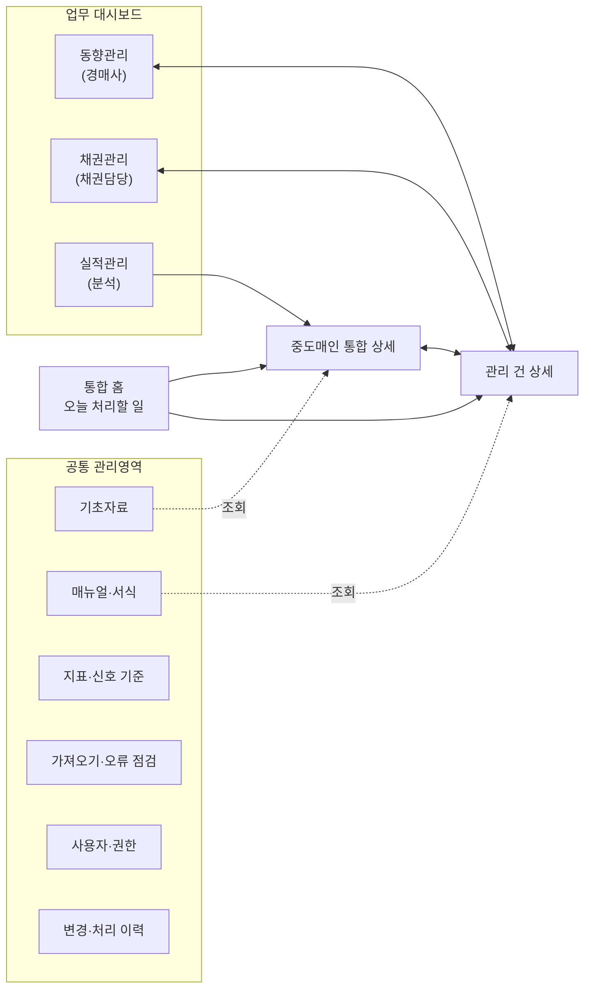
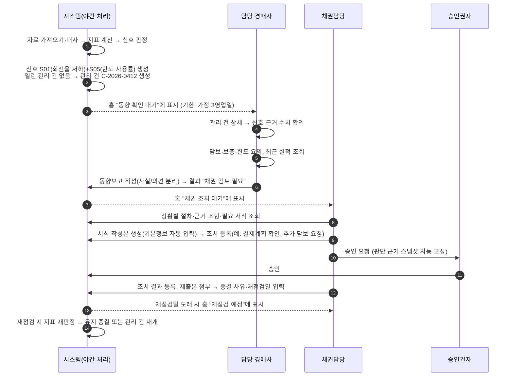
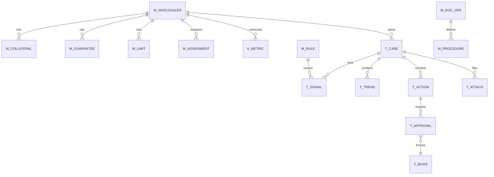
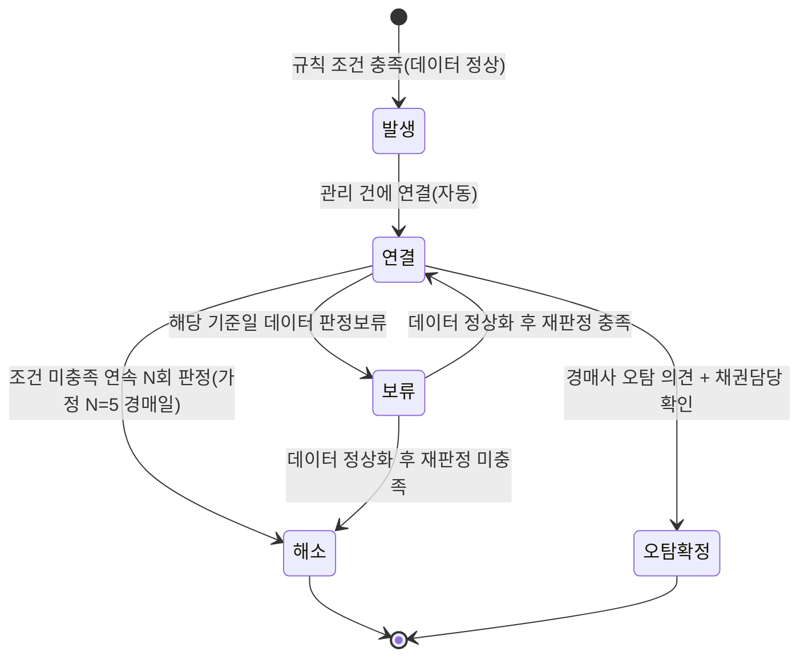
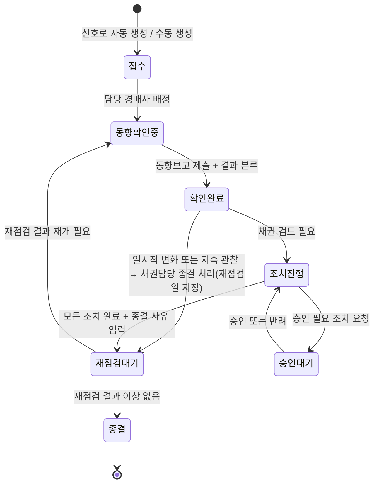

# 중도매인 통합관리 시스템 — 1차 상세 설계안 (v0.1)

| 항목 | 내용 |
|---|---|
| 문서 상태 | 초안(검토용). 코드 없음 |
| 작성일 | 2026-10-27 |
| 대상 | 농협경제지주 공판장 중도매인 관리 업무(채권·동향·실적) |
| 구현 기반(안) | Google Apps Script 웹앱 + Google Sheets + Google Drive |
| 데이터 | 이 문서의 모든 중도매인·금액·사례는 **가상**이다. 실제 사실이 아니다 |

### 표기 규칙

이 문서는 근거 수준을 아래 표시로 구분한다.

| 표시 | 의미 |
|---|---|
| **[확정]** | 요청서에 명시된 요구사항 |
| **[제안]** | 이 설계안이 제안하는 방식. 승인 전까지 변경 가능 |
| **[가정]** | 답이 없어 임시로 둔 값·조건. 운영 전 검증 필요 |
| **[확인 필요]** | 내부 규정·조직 기준을 확인하기 전에는 시스템이 확정하면 안 되는 사항 |

---

## 1. 핵심 결론과 시스템 범위

### 1.1 핵심 결론

1. **이 시스템의 중심은 "화면 3개"가 아니라 "관리 건(Case)"이다.** [제안]
   조기 신호가 발생하면 관리 건이 열리고, 동향보고·조치·승인·첨부·종결·재점검이 모두 같은 관리 건 ID에 쌓인다. 채권·동향·실적 대시보드는 같은 관리 건을 각자의 책임 관점으로 보는 "창"이다.

2. **연결 키는 두 개뿐이다.** [확정 + 제안]
   - `중도매인코드`: 모든 자료의 공통 기준 (누구의 자료인가)
   - `관리건ID`: 신호·동향보고·조치·첨부의 업무 연결 기준 (어떤 사안인가)

3. **책임은 겹치지 않게 나눈다.** [확정]
   동향관리 = 현장 사실 확인(경매사), 실적관리 = 정량 분석(시스템·분석 담당), 채권관리 = 공식 조치·승인·종결(채권담당). 같은 정보는 한 테이블에서만 수정하고 나머지 화면은 조회만 한다.

4. **자동화는 "찾고 모으는 일"까지만 한다.** [확정]
   신호 탐지, 자료 취합, 서식 자동 입력은 자동. 거래제한·한도변경·종결 판단은 담당자 검토와 승인.

5. **데이터가 불완전하면 "정상"이 아니라 "판정 보류"로 표시한다.** [확정]
   데이터 상태(자료 품질)와 위험 상태(영업 위험)를 별도 필드로 관리한다.

6. **Google Apps Script는 PoC와 소규모 운영에는 적합하지만, 조직의 클라우드 사용 승인이 선결 조건이다.** [확인 필요]
   요청자 계정이 개인 Gmail(소비자 계정)이라면 실제 중도매인·보증인 자료를 넣으면 안 되며, 가상 데이터로 기능 검증까지만 진행하는 것을 권한다(12장·13장).

### 1.2 시스템 범위

| 구분 | 포함 (초기 버전) | 제외 / 후순위 |
|---|---|---|
| 데이터 | 거래·입금·미수 잔액의 **일 단위 집계 자료** 가져오기, 기초자료(중도매인·담보·보증·한도) 관리 | 경매 낙찰 건별 원장 전체 적재(규모 문제), 원천 시스템 실시간 연동 |
| 탐지 | 규칙 기반 조기 신호, 데이터 품질 점검 | 머신러닝 부실 예측 |
| 업무 | 관리 건, 동향보고, 조치·승인 기록, 서식 작성본 생성, 재점검 | 전자결재 시스템 연동(별도 확인), 법적 채권 회수 절차 자체의 수행 |
| 문서 | 상황별 절차·근거 조항·서식 연결 | 자유 질의 AI 답변(4단계 선택 기능) |
| 분석 | 실적 지표, 12개월 추이, 전년 비교, 거래·회수 매트릭스 | 시장 가격·물량과의 연계 분석 |
| 기타 | 권한·이력·백업·재처리 | 모바일 전용 앱, 외부 공개 |

---

## 2. MECE 기능 구성표

### 2.1 메뉴 구조 개선 제안 [제안]

요청서의 기본 구조(통합 홈 / 3개 대시보드 / 공통 관리영역)를 유지하되 **공통 상세 화면 2개를 추가**한다.

| 추가 화면 | 이유 |
|---|---|
| **중도매인 통합 상세** (중도매인 360) | "모든 업무 화면에 통합 요약 제공" 요구를 화면마다 따로 구현하면 같은 정보가 3벌 생긴다. 한 화면을 만들고 모든 화면에서 이 화면(또는 축약 패널)을 호출한다 |
| **관리 건 상세** | 신호→동향→조치→종결 흐름이 3개 대시보드에 흩어지면 진행 상황을 한눈에 볼 수 없다. 관리 건 단위 타임라인 화면이 흐름의 "본체" 역할을 한다 |



### 2.2 기능 × 책임 × 데이터 관리 주체 (MECE 표)

"수정 권한을 가진 곳은 한 곳"이 원칙이다. 다른 화면은 모두 조회 전용이다.

| 기능 영역 | 하는 일 | 하지 않는 일 | 주 사용자 | 데이터 원본(유일한 수정 위치) |
|---|---|---|---|---|
| 데이터 가져오기 | 원천 자료 적재, 중복·누락·합계 점검, 재처리 | 자료 수정·보정 | 관리자 | 원천 자료 테이블 (사람이 수정 불가) |
| 기초자료 | 중도매인·담보·보증·한도 등록과 변경 이력 | 위험 판단 | 채권담당(입력) / 관리자(승인) | 기초자료 테이블 |
| 지표 계산 | 공통 산식으로 지표 산출, 기준일별 스냅샷 | 신호 발생 여부 판단 | 시스템 | 지표 스냅샷 테이블 |
| 신호 탐지 | 기준 대비 이상 여부 판정, 신호 생성·해소 | 사실 확인, 조치 결정 | 시스템(기준은 관리자) | 신호 테이블 |
| **동향관리** | 현장 사실 확인, 동향보고, 확인 결과 분류 | 공식 조치·승인 | 담당 경매사 | 동향보고 테이블 |
| **실적관리** | 구매·회수 실적 분석, 비교, 매트릭스 | 기록 생성(조회 전용) | 전원(조회) | 없음 (지표 스냅샷 조회) |
| **채권관리** | 조치 계획·실행·승인·종결·재점검 | 현장 확인 대체 | 채권담당 / 승인권자 | 조치·승인 테이블 |
| 관리 건 | 위 세 업무를 하나의 사안으로 묶고 상태 관리 | — | 채권담당(책임자), 경매사(참여) | 관리 건 테이블 |
| 매뉴얼·서식 | 문서 버전 관리, 상황별 절차·서식 연결 | 문서에 없는 절차 생성 | 관리자(문서 책임자) | 문서·절차 테이블, 원본 서식 폴더 |
| 사용자·권한 | 역할 부여, 담당 지정 | — | 관리자 | 사용자 테이블 |
| 변경·처리 이력 | 모든 쓰기·다운로드·작업 기록 | 수정·삭제 | 시스템(관리자 조회) | 이력 테이블 (추가만 가능) |

### 2.3 경계가 헷갈리기 쉬운 항목의 귀속 [제안]

| 항목 | 귀속 | 근거 |
|---|---|---|
| 신호 기준값 | 지표·신호 기준 관리 (관리자) | 경매사·채권담당 모두 영향을 받으므로 업무 화면에서 바꾸면 안 됨 |
| 신호 "오탐 처리" | 동향관리(경매사 제안) → 채권담당 확인 | 사실 확인은 경매사, 공식 종결은 채권담당 |
| 담보 평가금액·내부 인정금액 | 기초자료 (채권담당 입력, 관리자 승인) | 평가·인정은 공식 판단이므로 채권 영역 |
| 한도 변경 | 채권관리의 **조치**로 요청·승인 → 승인 완료 시 기초자료(한도)에 새 버전 반영 | 조치 근거와 한도 이력이 연결되어야 과거 재현 가능 |
| 미수금·연체 수치 | 원천 자료 + 지표 계산 (누구도 화면에서 수정 불가) | 대사 대상 수치는 사람 손을 타면 안 됨 |
| 데이터 이상 | 데이터 품질 대기열 (관리자) — 관리 건 아님 | 데이터 이상과 영업 위험의 분리 [확정] |

---

## 3. 대표 사용자 시나리오와 화면 연계

### 3.1 가상 사례 (실제 사실 아님)

- 중도매인 `W0123` "(가상)한빛청과", 취급 부류: 과일·채소, 담당 경매사 김OO(가상)
- 기준일 2026-10-26, 최근 3개월 미수금 회전율이 직전 3개월 대비 35% 하락, 한도 사용률 88%

### 3.2 흐름 (조기 신호 → 재점검)



### 3.3 화면 이동 연계

| 출발 화면 | 클릭 대상 | 이동 화면 | 전달값 |
|---|---|---|---|
| 통합 홈 | 업무 카드 | 관리 건 상세 | 관리건ID |
| 통합 홈 | 중도매인명 | 중도매인 통합 상세 | 중도매인코드 |
| 관리 건 상세 | [동향보고 작성] | 동향관리 > 보고 작성 | 관리건ID (중도매인·신호 자동 채움) |
| 관리 건 상세 | [조치 등록] | 채권관리 > 조치 등록 | 관리건ID |
| 관리 건 상세 | [실적 보기] | 실적관리 > 중도매인 상세 | 중도매인코드, 기준일 |
| 실적관리 매트릭스 | 점(중도매인) | 중도매인 통합 상세 | 중도매인코드 |
| 중도매인 통합 상세 | 진행 중 관리 건 | 관리 건 상세 | 관리건ID |
| 모든 화면 | 수치 옆 (i) | 산식·기준일·집계기간·원천 배치 팝업 | 지표 스냅샷 ID |

---

## 4. 화면별 구성·버튼·동작

### 4.0 모든 화면 공통 [확정 + 제안]

- **상단 기준 표시줄**: `기준일 2026-10-26 | 집계기간 2026-07-27~2026-10-26 | 최종 갱신 2026-10-27 06:12 | 데이터 상태: 정상/지연/누락` — 데이터 상태가 정상이 아니면 빨간 배지와 함께 원인 링크.
- **중도매인 요약 패널**(중도매인이 선택된 화면): 코드·상호·영업 상태·담당 경매사·적용 한도·미수금·연체·한도 사용률·진행 중 관리 건 수·[통합 상세] [실적] [채권] [동향] 이동 버튼.
- **권한 없는 항목**은 화면에서 숨기는 것과 별개로 서버가 데이터를 보내지 않는다(9장).

### 4.1 통합 홈 — "오늘 처리할 일"

| 영역 | 표시 내용 | 정렬·필터 | 버튼·동작 |
|---|---|---|---|
| 내 할 일 요약 | 아래 7개 대기열별 건수, 기한 초과 건수(빨강) | 기본: 로그인 사용자 담당분 | [전체 보기] 권한별 |
| ① 신규 조기 신호 | 중도매인별로 묶은 신호 목록. 예: `W0123 한빛청과 — 회전율 저하, 한도 사용률 88%` | 신호 수·심각도·발생일 | 행 펼치기 → 신호별 근거 수치(값·기준·비교값·기준일) / [관리 건 열기] |
| ② 동향 확인 대기·지연 | 관리 건, 확인 기한, 경과일 | 기한 임박순 | [동향보고 작성] |
| ③ 채권 조치 대기·지연 | 조치명, 담당, 기한, 승인 상태 | 기한 임박순 | [조치 열기] [승인 처리](승인권자) |
| ④ 담보·보증 기한 도래 | 담보ID/보증, 만기일, D-day | D-day순 | [기초자료 열기] |
| ⑤ 재점검 예정 | 관리 건, 재점검일, 지난 종결 사유 | 날짜순 | [재점검 시작] |
| ⑥ 데이터 갱신 실패·누락 | 배치, 원천, 오류 건수, 영향 중도매인 수 | 최근순 | [오류 상세] [재처리](관리자) |
| ⑦ 담당자별 미처리 | 담당자 × (대기/지연) 표 | 지연 많은순 | 담당자 클릭 → 해당 목록 (관리자·채권담당) |

### 4.2 중도매인 통합 상세 (공통)

| 탭 | 내용 | 원본 |
|---|---|---|
| 개요 | 기본정보, 영업 상태, 담당 경매사, 취급 부류, 거래 시작일 | 기초자료 |
| 채권 현황 | 미수금, 연체금액·연체일수, 최근 입금, 적용 한도(유형별 **개별 표시, 합산 안 함**), 한도 사용률 | 지표 스냅샷·한도 |
| 담보·보증 | 담보 목록(설정/평가/내부 인정 금액 구분), 만기, 검토 상태 / 보증 유무·범위·기간(보증인 상세는 권한자만) | 기초자료 |
| 실적 요약 | 최근 12개월 구매 추이(과일·채소·전체), 전년 동월 대비 | 집계 |
| 신호·관리 건 | 활성 신호, 진행·종결 관리 건 이력 | 신호·관리 건 |
| 이력 | 기초정보 변경, 한도 변경 이력 | 변경 이력 |

버튼: [관리 건 열기/새로 만들기(채권담당)] [동향보고 작성(경매사)] [기본정보 반영 서식 받기]

### 4.3 관리 건 상세 (공통, 흐름의 본체)

| 영역 | 내용 |
|---|---|
| 머리 | 관리건ID, 중도매인, 상태, 책임자(채권담당), 참여 경매사, 개시일, 경과일, 재발 여부(이전 관리건ID) |
| 연결된 신호 | 신호별 최초 발생일·최근 판정일·현재 값·해소 여부 |
| 타임라인 | 신호 → 동향보고(버전) → 확인 결과 → 조치·승인 → 종결 → 재점검 (시간순) |
| 판단 근거 스냅샷 | 승인·종결 시점에 고정된 한도·담보·지표·매뉴얼 버전 (읽기 전용) |
| 첨부 | 빈 서식 / 작성본 / 제출본 / 증빙 구분 표시 |
| 버튼 | [동향보고 작성] [확인 결과 분류] [조치 등록] [절차·서식 안내] [승인 요청] [종결] [재점검일 변경] [관리 건 병합](관리자) |

### 4.4 동향관리 (주 사용자: 담당 경매사)

**4.4.1 신호 목록**

| 열 | 예시 |
|---|---|
| 중도매인 | W0123 한빛청과 |
| 신호 | 회전율 저하(S01), 한도 사용률(S05) |
| 근거 수치 | 회전율 3.1회 → 2.0회 (-35%), 사용률 88% |
| 판정 기준 버전 | S01 v2 (적용일 2026-09-01) |
| 데이터 상태 | 정상 |
| 관리 건 / 상태 | C-2026-0412 / 동향 확인 중 |
| 확인 기한 | 2026-10-29 (D-2) |

버튼: [보고 작성] [빈 양식 받기] [기본정보 채운 양식 받기] [오탐 의견 제출]

**4.4.2 동향보고 작성** (자동 신호와 실제 확인 결과를 다른 영역에 배치) [확정]

| 구역 | 필드 | 입력 방식 |
|---|---|---|
| A. 자동 채움 (수정 불가) | 중도매인코드·상호, 관리건ID, 발생 신호·관련 수치·기준일, 작성일, 작성 경매사 | 시스템 |
| B. 확인 정보 | 확인일, 확인 방법(방문/전화/면담/자료 수령/기타), 확인 상대방(직위 수준까지. 실명은 [확인 필요]) | 필수 |
| C. **확인된 사실** | 사실 항목 목록(사실 1, 2…), 근거자료 첨부 연결 | 필수, 의견 금지 안내문 |
| D. 영업 상황·결제계획 | 영업 상황, 결제계획(금액·일자·방법) | 결제계획은 해당 시 필수 |
| E. **작성자 의견** | 자유 서술 | 선택, C와 별도 칸 |
| F. 확인 결과 분류 | 일시적 변화 / 지속 관찰 / 채권 검토 필요 / 판정 보류(자료 부족) | 필수, 단일 선택 |
| G. 후속 | 추가 확인사항, 후속 조치·담당자·기한, 재점검일 | "채권 검토 필요" 선택 시 후속 담당자 기본값=채권담당 |

버튼: [임시 저장] [제출] [PDF 출력] — 제출 후 수정은 새 버전 생성(이전 버전 보존).

**4.4.3 공식 원본 기준** [제안]

| 방식 | 공식 원본 | 처리 |
|---|---|---|
| 화면 입력 (권장 기본) | **시스템 입력 데이터** | PDF는 입력 데이터로부터 생성되는 출력본 |
| 파일 작성 후 업로드 (현장 사정상 예외) | 업로드 파일 + 화면의 **최소 필드**(확인일·결과 분류·재점검일) | 본문 재입력 요구 안 함. 대신 검색·집계 대상은 최소 필드만 |
| 서명이 필요한 경우 | 시스템 데이터 + 서명본 스캔 첨부 | 서명본은 "제출본"으로 잠금 |

이중 입력을 줄이는 핵심: 파일 양식에 관리건ID를 인쇄해 업로드 시 자동 연결하고, 화면에는 결과 분류·기한 같은 "업무 흐름을 움직이는 필드"만 받는다.

### 4.5 채권관리 (주 사용자: 채권담당, 승인권자)

**4.5.1 현황**

| 영역 | 내용 |
|---|---|
| 목록 | 중도매인별 미수금, 연체금액, 최장 연체일수, 최근 입금일·금액, 한도(기본/마감/추가 **각각**), 한도 사용률, 데이터 상태, 진행 중 관리 건 |
| 필터 | 연체 있음, 한도 사용률 구간, 관리 건 상태, 담당자, 부류 |
| 통합 검토 패널 | 선택 중도매인의 담보·보증·최근 동향보고 요약·최근 실적 (각 원본 조회) |

**4.5.2 절차·서식 안내** (초기: 상황 코드 기반, 4단계: 자유 질의 확장)

답변 형식 [확정]:

```
[기준] 중도매인 데이터 기준일 2026-10-26 / 매뉴얼: 채권관리 업무매뉴얼 v3.2(시행 2026-03-01)
1. 확인된 상황   : 연체 18일, 한도 사용률 88%, 동향보고 결과 '채권 검토 필요'(2026-10-28)
2. 추가 확인사항 : 결제계획 이행 여부, 담보 평가 최신성(최종 확인 2025-12-10)
3. 적용 가능 절차: ① … ② … (각 단계에 근거 표시)
4. 근거          : 문서명 / 조항 / 쪽수 / 시행일
5. 필요 서식     : [서식명 v버전] [빈 서식 받기] [작성본 만들기]
6. 다음 할 일    : 조치 등록 → 승인 요청 (기한 제안: 확인 필요)
```

- 상황에 연결된 절차가 없으면 3·4번에 **"확인 필요 — 등록된 근거 문서 없음"**만 표시하고 절차를 만들지 않는다.
- 같은 상황에 서로 다른 절차가 연결되면 **"문서 간 충돌"** 배지와 두 문서의 조항을 나란히 표시한다.

**4.5.3 조치 관리**

| 필드 | 설명 |
|---|---|
| 조치ID, 관리건ID | 연결 |
| 조치 유형 | 결제 독려, 결제계획 확인, 추가 담보 요청, 한도 조정 요청, 거래 조건 변경 요청 등 — **목록은 [확인 필요]** |
| 담당자, 처리기한 | 필수 |
| 조치 내용 | 필수 |
| 승인 필요 여부 | 조치 유형별 기본값(기준 테이블). 거래제한·한도변경은 항상 승인 필요 [확정] |
| 승인 상태 | 미요청 / 승인 대기 / 승인 / 반려 |
| 결과 | 결과 내용, 완료일, 제출본 첨부 |

버튼: [작성본 만들기] [승인 요청] [승인] [반려(사유 필수)] [결과 등록] [관리 건 종결]

**4.5.4 종결**: 종결 사유(해소 확인 / 일시적 변화로 확인 / 조치 완료 / 거래 종료 / 기타-사유 필수), 재점검일(필수, 기본값은 [가정] 종결일+30일), 종결 승인 여부는 [확인 필요].

### 4.6 실적관리 (조회·분석 전용)

| 탭 | 내용 |
|---|---|
| 요약 | 부류(과일/채소/전체)별 구매금액·구매일수·구성비, 전년 동월 대비, 전년 동기 누적 대비 |
| 추이 | 최근 12개월 월별 막대 + 전년 대응 월 선, 진행 중 월은 "동일 경과 경매일 기준" 표시 |
| 회수 | 미수금 회전율·회수일수(**전체 기준만**, 부류별 배분 근거가 없을 때), 연체금액·연체일수·한도 사용률 |
| 비교 | 중도매인별 순위·비교표, 다운로드 |
| 매트릭스 | 거래·회수 4분면(6.6절) |
| 상세 | 중도매인 1명의 월별 상세 |

화면 고정 문구(부류별 채권 배분 근거가 없을 때): **"회전율·회수일수는 부류 구분 없이 전체 기준입니다. 부류별 채권 배분 근거가 없어 부류별 회전율을 산출하지 않습니다."**

### 4.7 공통 관리영역

| 화면 | 주요 동작 |
|---|---|
| 중도매인 기초자료 | 등록·수정(변경 사유 필수), 담보·보증·한도 버전 등록, 증빙 업로드, 과거 시점 조회("기준일로 보기") |
| 매뉴얼·서식 관리 | 문서 등록, 버전 등록(시행일·폐지일), 상황 코드↔절차↔서식 연결, 충돌 점검 |
| 사용자·권한 | 사용자 등록, 역할 부여, 담당 중도매인 지정(기간 포함) |
| 지표·신호 기준 | 기준 버전 등록(적용일), 시뮬레이션(과거 데이터로 신호 건수 미리보기), 승인 |
| 데이터 가져오기·오류 점검 | 파일 업로드/폴더 감시, 배치 결과, 오류 행, 대사 결과, [재처리] |
| 변경·처리 이력 | 대상·사용자·기간별 조회, 내보내기(관리자) |

---

## 5. 데이터 구조

### 5.1 저장소 분리 원칙 [제안]

| 저장소(스프레드시트 파일) | 내용 | 사람이 직접 편집 | 비고 |
|---|---|---|---|
| `DB_RAW` 원천 | 가져온 거래·입금·잔액 자료, 배치 기록 | 불가 | 추가만. 정정도 새 행 |
| `DB_MASTER` 기초 | 중도매인·담보·보증·한도·사용자·기준·문서 | 웹앱 통해서만 | 유효기간형 버전 관리 |
| `DB_PII` 민감 | 보증인 개인정보, 연락처 상세 | 불가 | 별도 파일, 최소 공유 |
| `DB_WORK` 업무 | 신호·관리 건·동향보고·조치·승인·첨부 | 웹앱 통해서만 | 행 버전으로 충돌 방지 |
| `DB_AGG` 집계 | 일·월 집계, 지표 스냅샷, 홈 대기열 캐시 | 불가 | **언제든 원천에서 재생성 가능** |
| `DB_LOG` 이력 | 변경 이력, 작업 로그, 다운로드 기록 | 불가 | 추가만 |
| Drive 폴더 | 원본 서식(읽기 전용), 관리 건별 폴더(작성본·제출본·증빙), 원천 파일 보관, 백업 | 폴더별 권한 | |

파일을 나누는 이유: 권한을 파일 단위로 다르게 줄 수 있고, 한 파일의 크기·잠금 경합을 줄이며, 집계 파일은 깨져도 원천에서 다시 만들 수 있다.

### 5.2 공통 필드 (모든 업무·기초 테이블)

`created_at, created_by, updated_at, updated_by, row_version(정수, 동시 수정 검사), is_deleted(논리 삭제)`

유효기간형 테이블 추가 필드: `valid_from, valid_to(미정 시 9999-12-31), version_no, change_reason, approved_by`

### 5.3 테이블 정의

#### 기초자료 (DB_MASTER)

| 테이블 | 한 행의 의미 | 기본키 | 연결키 | 필수 필드 | 갱신 방식 |
|---|---|---|---|---|---|
| M_WHOLESALER 중도매인 | 중도매인 1명의 **현재** 기본정보 | wholesaler_id | — | 상호, 대표자, 영업상태, 거래시작일, 취급부류 | 수정 시 이력 테이블에 이전값 기록 |
| M_WS_STATUS_HIST 영업상태 이력 | 특정 기간의 영업 상태 | status_hist_id | wholesaler_id | 상태(정상/휴업/폐업/신규), valid_from, valid_to | 유효기간형 |
| M_ASSIGNMENT 담당 지정 | 특정 기간 중도매인의 담당 경매사 | assign_id | wholesaler_id, user_id | valid_from, valid_to | 유효기간형 (권한 판정에 사용) |
| M_CONTACT 업무 연락처 | 업무용 연락 수단 1개 | contact_id | wholesaler_id | 유형, 값 | 필요 최소 범위 [확인 필요] |
| M_COLLATERAL 담보 | 담보 1건의 **특정 버전** | (collateral_id, version_no) | wholesaler_id | 종류, 설정금액, 평가금액, 평가일, 내부 인정금액, 확인일, 검토상태, 만기일(해당 시) | 값이 바뀌면 새 버전 행 |
| M_GUARANTEE 연대보증 | 보증 1건의 특정 버전 | (guarantee_id, version_no) | wholesaler_id, guarantor_ref | 보증여부, 범위, 한도, 기간, 확인일 | 유효기간형 |
| P_GUARANTOR 보증인 (DB_PII) | 보증인 1명 | guarantor_ref | — | 성명, 관계 등 **최소 항목** | 권한자만 |
| M_LIMIT 한도 | 한도 1건(유형별)의 특정 버전 | (limit_id, version_no) | wholesaler_id, approval_action_id | 한도유형(기본/마감/추가), 금액, 적용기간, 승인근거, 승인자 | 유효기간형. **유형 간 합산 컬럼 없음** |
| M_EVIDENCE 증빙 | 증빙 파일 1개 | evidence_id | 대상 테이블·ID | Drive 파일ID, 파일 해시, 문서 유형 | 추가만 |
| M_USER 사용자 | 사용자 1명 | user_id(이메일) | — | 이름, 역할, 상태 | 관리자 |
| M_RULE 신호 기준 | 신호 규칙 1개의 특정 버전 | (rule_id, version_no) | — | 산식 코드, 파라미터(JSON), 적용일, 상태(초안/승인/폐지), 승인자 | 버전 추가 |
| M_CALENDAR 경매 일정 | 하루 | date | — | 경매일 여부, 휴장 사유 | 연 1회 등록 |
| M_DOC 문서 | 매뉴얼·서식 1종 | doc_id | — | 문서명, 유형(매뉴얼/서식), 소관 | |
| M_DOC_VER 문서 버전 | 문서 1종의 버전 1개 | (doc_id, version) | — | 시행일, 폐지일, Drive 파일ID, 해시 | 버전 추가 |
| M_PROCEDURE 절차 | 상황 1개에 대한 절차 단계 1개 | proc_step_id | situation_code, (doc_id, version) | 단계 순서, 내용, 조항, 쪽수 | 문서 버전 단위로 등록 |
| M_PROC_FORM 절차-서식 연결 | 절차 단계에 필요한 서식 1개 | (proc_step_id, form_doc_id) | | | |

#### 원천 자료 (DB_RAW)

| 테이블 | 한 행의 의미 | 기본키 | 중복 방지 키 | 필수 필드 | 갱신 |
|---|---|---|---|---|---|
| R_BATCH 가져오기 배치 | 파일 1회 가져오기 | batch_id | 파일 해시 + 원천 + 기준일 | 원천명, 파일명, 해시, 기준일, 행 수, **관리 합계(원천이 제공한 총액)**, 상태 | 상태만 갱신 |
| R_SALES 판매(구매) | 원천 자료의 판매 1행 (단위는 원천 형식에 따름 [확인 필요]) | raw_id | 원천 거래번호+행번호 (없으면 주요 필드 해시) | 거래일, 중도매인, 부류, 금액, 거래구분(현금/외상), 정정 여부, 원거래 참조 | 추가만. 정정은 새 행 |
| R_RECEIPT 입금 | 입금 1건 | raw_id | 원천 입금번호 | 입금일, 반영일, 중도매인, 금액, 구분 | 추가만 |
| R_AR_BAL 미수 잔액 | 중도매인 × 일자의 원천 잔액 | raw_id | 중도매인+일자+배치 | 잔액, 연체금액, 최장 연체일수(원천 제공 시) | 추가만, 최신 배치 우선 |
| R_REJECT 오류 행 | 가져오지 못한 행 1개 | reject_id | batch_id+행번호 | 오류 코드, 원문 | 재처리 시 해결 표시 |

#### 집계 (DB_AGG, 재생성 가능)

| 테이블 | 한 행의 의미 | 기본키 | 비고 |
|---|---|---|---|
| A_DAILY 일 집계 | 중도매인 × 일자 × 부류 | (wholesaler_id, date, category) | 구매금액, 외상매출, 현금매출, 입금, 잔액(전체 행에만), 구매 여부 |
| A_MONTHLY 월 집계 | 중도매인 × 월 × 부류 | (wholesaler_id, ym, category) | 구매금액, 구매일수, 경매일수 |
| A_METRIC 지표 스냅샷 | 중도매인 × 기준일 × 지표 × 부류 | metric_snap_id (자연키: ws+기준일+지표+부류+calc_run_id) | 값, 분자, 분모, 집계기간, **산출 상태(정상/산출불가/비교불가/판정보류) + 사유 코드**, 산식 버전, calc_run_id |
| A_RECON 대사 결과 | 기준일 × 대사 항목 | (기준일, 항목) | 시스템 합계, 원천 관리 합계, 차이, 판정 |
| A_DQ 데이터 품질 | 중도매인 × 기준일 | (wholesaler_id, 기준일) | 상태(정상/지연/누락/불일치), 원인 |
| A_HOME_QUEUE 홈 대기열 | 사용자 × 대기열 항목 | queue_item_id | 매 처리 후 재생성 (조회 속도용) |

#### 업무 (DB_WORK)

| 테이블 | 한 행의 의미 | 기본키 | 연결키 | 필수 필드 | 갱신 |
|---|---|---|---|---|---|
| T_SIGNAL 신호 | 한 중도매인에서 **한 규칙의 조건이 연속으로 충족된 한 구간** | signal_id | wholesaler_id, (rule_id, version), case_id | 최초 발생 기준일, 최근 판정 기준일, 근거 수치(JSON), 상태 | 같은 구간은 기존 행의 최근 판정일·수치만 갱신 |
| T_CASE 관리 건 | 한 중도매인의 한 사안 | case_id | wholesaler_id, parent_case_id(재발) | 상태, 책임자, 개시일, 재발 여부, 종결 사유, 재점검일 | 상태 전환 시 이력 기록 |
| T_TREND 동향보고 | 동향보고 1건의 버전 1개 | (report_id, version) | case_id, wholesaler_id | 4.4.2의 필드, 사실·의견 분리 | 제출 후 수정 = 새 버전 |
| T_TREND_FACT 확인 사실 | 보고서 속 사실 1개 | fact_id | report_id, version | 사실 내용, 근거 첨부ID | |
| T_ACTION 조치 | 조치 1건 | action_id | case_id | 유형, 담당자, 기한, 내용, 승인필요, 상태 | |
| T_APPROVAL 승인 | 승인 요청 1회 | approval_id | action_id 또는 case_id, basis_snapshot_id | 요청자, 승인자, 결과, 사유, 일시 | 추가만 |
| T_BASIS 판단 근거 스냅샷 | 승인 요청·종결 시점의 근거 묶음 | basis_snapshot_id | case_id | 참조한 한도·담보·보증 (id, version), 지표 스냅샷 ID, 매뉴얼 (doc_id, version), 데이터 기준일 | **불변** |
| T_ATTACH 첨부 | Drive 파일 1개 | attach_id | case_id / report_id / action_id | 구분(빈 서식/작성본/제출본/증빙), 원본 서식 (doc_id, version), 해시, 잠금 여부 | 제출본은 잠금 |
| T_CASE_HIST 관리 건 상태 이력 | 상태 전환 1회 | hist_id | case_id | 이전·이후 상태, 사유, 사용자 | 추가만 |

#### 이력 (DB_LOG)

| 테이블 | 한 행의 의미 |
|---|---|
| L_AUDIT 변경 이력 | 쓰기 요청 1회 (테이블, 키, 변경 전·후 값, 사용자, 시각, 요청ID) |
| L_JOB 작업 로그 | 정기·수동 작업 1회 (단계, 시작·종료, 처리 건수, 오류, 재처리 원본 ID) |
| L_ACCESS 주요 접근 | 파일 생성·다운로드, 보증인 상세 조회, 권한 거부 1회 |

### 5.4 데이터 관계



### 5.5 관리 건 묶음 규칙: 동일 사안·재발·신규 [제안]

| 상황 | 처리 | 근거 |
|---|---|---|
| 중도매인에게 **열린 관리 건이 있음** + 새 신호 | 기존 관리 건에 연결 (새 관리 건 없음) | 경매사의 확인·채권 판단은 중도매인 단위로 이뤄지고, 복수 징후가 함께 오는 경우가 많음 |
| 같은 신호 구간이 계속됨 | 신호 행 갱신만 (새 신호 없음) | 매일 같은 경보 반복 방지 |
| 열린 관리 건 없음 + 최근 종결 관리 건이 **재발 판단 기간 이내**(가정 90일) + 같은 신호 계열 | **재발**: 새 관리 건 생성, parent_case_id에 이전 건 연결, 홈에 "재발" 표시 | 종결 건을 다시 열면 종결 판단·이력이 흐려짐 |
| 그 외 | **신규** 관리 건 | |
| 데이터 이상 | 관리 건 생성 안 함. 데이터 품질 대기열로 | 데이터 이상 ≠ 영업 위험 |
| 담보·보증 기한 도래만 있음 | 관리 건 아님. "기한 도래" 업무로 처리 (사용자가 관리 건으로 전환 가능) | 정기 업무와 위험 사안 구분 |

신호 계열 [가정]: 회수 계열(S01 회전율, S02 미수 증가, S03 연체, S05 한도), 거래 계열(S04 구매 급감).
대안: 사안 유형별로 관리 건을 여러 개 여는 방식 — 원인이 다른 사안을 분리할 수 있으나 같은 중도매인에 대해 경매사가 여러 보고서를 써야 하므로 초기에는 권하지 않는다. 필요 시 관리자의 [관리 건 분리/병합] 기능으로 보완한다.

---

## 6. 지표 정의와 예외 처리

### 6.1 지표 정의 (출발점 산식 — 내부 기준과 대조 필요)

| 지표 | 산식 | 집계기간 [가정] | 단위 | 부류별 산출 | 내부 기준 대조 항목 [확인 필요] |
|---|---|---|---|---|---|
| 미수금 회전율 | 기간 외상매출액 ÷ 기간 평균 미수금 | 최근 3개월(롤링, 기준일 포함 직전 91일) | 회 (기간 기준, 연환산 안 함) | **배분 근거 있을 때만** | 외상매출 범위(수수료·운송비 포함 여부), 평균 방식 |
| 회수일수 | 기간 일수 ÷ 기간 회전율 | 회전율과 동일 | 일 | 회전율과 동일 | 달력일 vs 경매일 |
| 구매 증감률 | 당기 구매금액 ÷ 전년 비교기간 구매금액 − 1 | 월, 누적(YTD) | % | 가능 | 구매금액 = 낙찰금액? 정산금액? |
| 한도 사용률 | 한도 산정 대상 채권액 ÷ 적용 한도 | 기준일 시점 | % | 불가 | **산정 대상 채권, 적용 한도(유형 결합 방식)** |
| 구매일수 | 구매 실적이 있는 경매일 수 | 월 | 일 | 가능 | |
| 구성비 | 부류 구매금액 ÷ 전체 구매금액 | 월·누적 | % | — | |
| 연체금액·연체일수 | 원천 제공값 우선 | 기준일 | 원·일 | 불가 | **연체 정의(약정 결제일 기준 등)** |

### 6.2 평균 미수금 산출 방식

| 순위 | 방식 | 조건 | 한계 표시 |
|---|---|---|---|
| 1 (우선) | 일별 잔액 평균 (기간 모든 달력일의 잔액 평균, 휴장일은 직전 잔액 유지) | 원천에서 일별 잔액 제공 또는 거래·입금으로 일별 잔액 재구성 가능 | — |
| 2 | 주말(또는 경매일) 잔액 평균 | 일별 불가, 주 단위 가능 | "주 단위 잔액 평균" 표시 |
| 3 | (기초 잔액 + 기말 잔액) ÷ 2 | 월말 잔액만 있음 | "기초·기말 평균 — 기간 중 변동 미반영" 경고 |

지표 스냅샷에 `avg_method` 코드를 저장하고 화면 (i) 팝업에 표시한다. 방식이 다른 값끼리 순위 비교하지 않는다.

### 6.3 예외 처리

| 예외 | 처리 | 화면 표시 |
|---|---|---|
| 평균 미수금 = 0 | 회전율 **산출불가** (무한대 표시 금지). 외상매출도 0이면 "외상거래 없음" | "산출불가: 미수 잔액 없음" |
| 비교기간 구매금액 = 0 | 증감률 **비교불가**. 당기 금액만 표시 | "전년 실적 없음" |
| 신규 중도매인 (거래 시작 후 집계기간 미달) | 비교 지표 비교불가, 회전율은 경과 기간으로 산출하되 "신규" 배지, **구매 급감 신호 제외** | "신규(거래 n개월)" |
| 휴업 | 해당 기간 구매 신호 제외, 채권 신호는 유지 | "휴업 중" |
| 폐업 | 실적 분석 제외, 채권 잔액이 있으면 채권 지표 유지 | "폐업" |
| 자료 누락·갱신 실패 | 해당 기준일 지표 **판정보류**, 신호 판정 안 함 | 상단 기준 표시줄 빨강 + "판정 보류(자료 불완전)" |
| 입금 지연 반영 (입금일 ≠ 반영일) | 잔액은 반영일 기준 원천값, 연체 판단은 원천값 우선. 차이가 알려진 경우 "반영 지연 가능" 표시 [확인 필요: 어느 일자가 공식] | 각주 |
| 반품·취소·정정 | 원거래 참조가 있으면 **원거래일** 기준으로 재집계. 원거래 참조가 없으면 처리일 기준 + 데이터 품질 경고 | 정정 건수 표시 |
| 소급 입력 | 영향 받은 과거 기준일 재계산(새 calc_run). **이미 판단에 쓰인 스냅샷은 보존**하고 "이후 정정됨" 표시 | 스냅샷 비교 |
| 현금·외상 혼재 | 구매금액 = 현금+외상, 회전율 분자 = 외상만. 거래구분이 없는 자료는 회전율 산출불가 | "거래구분 없음" |
| 부류별 채권 배분 불가 | 구매는 부류별, 회전율·회수일수·한도 사용률은 **전체만** | 4.6절 고정 문구 |
| 거래조건 차이 (결제 주기 상이) | 결제 주기 그룹을 기초자료에 두고 그룹 내 비교만 권장 [확인 필요: 결제 조건 자료 유무] | 그룹 표시 |
| 계절성 | 구매 급감 신호에 이중 조건(6.5) + 부류 전체 시장 변화 대비 상대 증감 | "시장 전체 −25% 대비 −5%p" 형식 |

### 6.4 진행 중인 월의 비교 기준 [제안]

- 기본: **동일 경과 경매일 기준**. 예) 2026-10-26 현재 10월 경매일 22일 경과 → 전년 10월의 처음 22 경매일과 비교.
- 대안: 동일 달력일(1~26일). 휴장일 배치가 해마다 달라 왜곡 가능.
- 경매 일정(M_CALENDAR)이 없으면 달력일 기준으로 대체하고 화면에 표시한다.
- 월 전체 비교는 월이 끝난 뒤(마감 후)에만 표시. [확인 필요: 공판장의 월 마감 기준일]

### 6.5 조기 신호 규칙 (모든 수치는 [가정])

| 코드 | 신호 | 판정 조건 (가정값) | 제외 조건 | 심각도(가정) |
|---|---|---|---|---|
| S01 | 미수금 회전율 저하 | 최근 3개월 회전율이 직전 3개월 대비 **30% 이상 하락** AND 회수일수 **≥ 20일** | 신규, 판정보류, 평균 방식 3 | 주의 |
| S02 | 미수금 증가 | 기준일 잔액 ≥ 최근 3개월 평균 잔액 × **1.3** AND 증가액 ≥ **최소 금액(미정)** | 판정보류 | 주의 |
| S03 | 연체 발생·장기화 | 연체 발생(연체일수 ≥ 1) / 장기화(≥ **30일**) | 연체 정의 확정 전 원천값만 사용 | 경고/위험 |
| S04 | 구매실적 급감 | 전년 동월(동일 경과일) 대비 **−40% 이하** AND 직전 3개월 평균 대비 **−30% 이하** AND 부류 전체 증감률과의 차이 **−20%p 이하** | 신규, 휴업, 폐업 | 주의 |
| S05 | 한도 사용률 상승 | ≥ **80%** 주의, ≥ **95%** 경고 | **적용 한도 정의 확정 전에는 "참고 신호"로만 표시** | 주의/경고 |
| S06 | 담보·보증 기한 도래 | 만기 D-**60**, D-**30** | — | 정보(기한 업무) |
| S07 | 복수 징후 | 같은 기준일에 영업위험 신호(S01~S05) **2개 이상** | — | 한 단계 상향 |

**가정값 검증 방법** [제안]

1. 과거 24~36개월 자료로 기준일마다 규칙을 재실행(백테스트)한다.
2. 정답 표본: 과거 실제로 채권 조치·장기 연체·거래 중단이 있었던 중도매인-시점 (채권담당이 목록 제공).
3. 측정: (a) 실제 사안 중 사전에 신호가 났던 비율(포착률), (b) 신호 중 실제 사안으로 이어진 비율(적중률), (c) 사안 발생 몇 주 전에 잡았는지(선행 기간), (d) 경매사 1인당 주간 신호 건수(업무량).
4. 경매사 1인당 처리 가능한 건수를 상한으로 두고 포착률이 가장 높은 조합을 선택한다.
5. 운영 전 **4~8주 그림자 운영**(신호는 생성하되 업무 배정 안 함)으로 오탐 비율을 확인한다. 기간은 [가정].

과거 정답 표본이 적으면(수십 건 이하) 통계적 최적화가 불가능하므로, 수치는 "업무량 상한" 기준으로 정하고 운영하며 조정한다는 한계를 명시한다.

### 6.6 거래·회수 매트릭스 (업무용 4분면)

| 요소 | 기본 제안 |
|---|---|
| 가로축 | 최근 12개월 구매금액 (로그 눈금 권장 — 금액 편차가 큼) |
| 세로축 | 최근 3개월 미수금 회전율 (**전체 기준**. 부류 필터와 무관하다는 표시) |
| 색상 | 전년 동기 대비 구매 증감률 (감소=주황 계열, 증가=청록 계열, 비교불가=회색) |
| 점 크기 | 현재 미수금 |
| 필터 | 과일·채소·전체 (가로축·색상에만 적용) |
| 제외·별도 표시 | 신규(12개월 미만), 휴업·폐업, 판정보류 — 그래프 밖 목록으로 |

분류: 구매↑·회전율↑ 핵심 유지군 / 구매↑·회전율↓ **집중 점검군** / 구매↓·회전율↑ 육성 검토군 / 구매↓·회전율↓ 개별 진단군.

**경계선 설정 방식 비교**

| 방식 | 장점 | 단점 |
|---|---|---|
| 당월 중앙값 | 자료만 있으면 즉시 가능, 항상 4분면에 고르게 분포 | 전체가 나빠져도 절반은 "높음". 기준이 매월 움직여 분류가 흔들림 |
| 구매금액 가중 중앙값 | 대형 중도매인 영향 반영 | 설명이 어렵고 소수 대형 업체에 끌림 |
| 목표값·내부 기준값 | 절대 기준, 의미가 명확 | 근거 규정이 필요. 분포가 한쪽으로 쏠릴 수 있음 |
| 기준연도 고정 중앙값 (연 1회 갱신) | 해마다 비교 가능, 분류 안정적 | 시장 구조가 연중 바뀌면 늦게 반영 |

**권장안** [제안]: 가로축 = 부류 필터별 **당기 중앙값**(규모 순위는 상대 개념이므로), 세로축 = **전년도 연간 중앙값으로 고정**(지표·신호 기준 관리에 등록, 연 1회 갱신), 내부 목표 회전율이 확정되면 세로축을 목표값으로 교체. 화면에 경계선 값·산정 방식·산정일을 항상 표시한다.

화면 고정 문구 [확정]: **"이 분류는 관리 우선순위를 찾기 위한 참고 자료이며, 신용등급이나 거래제한 기준이 아닙니다."** — 분류 결과는 신호·조치 판단에 자동 연결하지 않는다.

### 6.7 데이터 상태와 위험 상태 분리

| 데이터 상태 \ 위험 상태 | 신호 없음 | 신호 있음 |
|---|---|---|
| 정상 | **정상** | 신호 표시 |
| 지연·누락·불일치 | **판정 보류** (정상으로 표시 금지) | 직전 정상 기준일 신호 + "자료 불완전" |

---

## 7. 신호·관리 건의 상태와 전환 조건

### 7.1 신호 상태



- 해소된 신호의 같은 규칙이 다시 충족되면 **새 신호 구간**(새 signal_id)이 된다.
- 오탐 확정 사유는 기준 조정 검토 자료로 집계한다(불필요한 경보 비율).

### 7.2 관리 건 상태



| 전환 | 조건 (시스템 검사) | 수행자 |
|---|---|---|
| 접수 → 동향확인중 | 담당 경매사 존재(M_ASSIGNMENT 유효) | 자동 |
| 동향확인중 → 확인완료 | 제출된 동향보고 ≥ 1, 결과 분류 입력, 확인일·확인 방법·사실 ≥ 1 | 경매사 |
| 확인완료 → 조치진행 | 결과 = 채권 검토 필요 | 자동 |
| 조치진행 → 재점검대기 | 열린 조치 0건, 승인 필요 조치는 모두 승인, 종결 사유·재점검일 입력, **판단 근거 스냅샷 생성** | 채권담당 |
| 재점검대기 → 종결 | 재점검일 도래, 재점검 판정(활성 신호 없음 + 담당자 확인) | 채권담당 |
| 결과 = 판정 보류(자료 부족) | 동향확인중 유지, 데이터 품질 대기열에 연결 | — |

**처리 기한(SLA)** [가정]: 동향 확인 3경매일, 조치 등록 5경매일, 승인 3경매일. 기한 초과 시 "지연"으로 홈에 표시. 실제 기한은 [확인 필요].

---

## 8. 매뉴얼·서식 연결 방식

### 8.1 구조


### 8.2 규칙

| 항목 | 규칙 |
|---|---|
| 상황 코드 | 관리 건의 사실(신호 조합, 결과 분류, 조치 유형)로 결정. 상황 코드 목록과 판정 조건은 채권담당과 함께 정의 [확인 필요] |
| 근거 없음 | 상황 코드에 유효한 절차가 없으면 **"확인 필요"** 표시, 문서 담당자에게 요청 기록 생성 |
| 충돌 | 같은 상황 코드에 유효 문서가 2개 이상이고 단계가 다르면 **충돌 표시** + 두 근거를 나란히. 시스템이 우선순위를 정하지 않음 |
| 시행일 | 기준일에 유효한 문서 버전만 사용. 과거 관리 건은 당시 버전을 판단 근거 스냅샷으로 보존 |
| 3단계 파일 구분 | **원본 서식**(승인본, 서식 폴더, 편집 권한 없음) / **작성본**(복사본, 관리 건 폴더, 파일명 `관리건ID_서식명_v버전_작성본_일시`) / **제출본**(최종, 잠금, 해시 기록) |
| 원본 보호 | 작성본은 항상 `makeCopy`로 생성. 원본 파일 ID에는 쓰기 호출을 하지 않음(코드 검사 항목) |
| 자동 입력 | 서식 내 `{{상호}}`, `{{대표자}}`, `{{미수금}}`, `{{기준일}}` 같은 자리표시자만 치환. 입력값에 기준일 함께 기재 |
| 다운로드 기록 | 빈 서식·작성본·제출본 다운로드 모두 L_ACCESS 기록 |

### 8.3 자유 질의응답(AI) — 4단계 선택 기능

| 검토 항목 | 내용 |
|---|---|
| 의존성 | 핵심 업무(조회·동향 입력·서식·조치)는 AI 없이 동작. AI 장애 시 상황 코드 안내로 대체 [확정] |
| 데이터 제공 범위 | 매뉴얼 본문만 제공 / 중도매인 데이터는 미제공 또는 익명화 수치만 — [확인 필요: 조직 생성형 AI 보안서약서·사용 기준] |
| 답변 통제 | 등록된 문서 내 근거 인용이 없으면 답변 대신 "확인 필요". 답변에 문서·조항·쪽수·버전 필수 |
| 비용 | 질의 건수 × 단가 — 사용 서비스 확정 후 산정 |
| 기록 | 질의·답변·인용 근거 저장, 업무 판단 근거로 단독 사용 금지 |

---

## 9. 권한과 변경 이력

### 9.1 역할별 권한표 [제안]

범례: ● 가능, ◐ 담당분만, ○ 조회만, — 불가

| 기능 | 경매사 | 채권담당 | 관리자 | 조회자 |
|---|---|---|---|---|
| 통합 홈 | ◐ | ● | ● | ○ |
| 중도매인 기본정보 조회 | ○(전체 조회 여부 [확인 필요]) | ○ | ○ | ○ |
| 기본정보·담보·보증·한도 등록·수정 | — | ● | ●(승인) | — |
| 보증인 상세(개인정보) | — | ● | ● | — |
| 미수금·연체·한도 조회 | ◐ | ● | ● | ○ |
| 동향보고 작성·수정 | ◐ | ○ | ○ | — |
| 확인 결과 분류 | ◐ | ○ | ○ | — |
| 오탐 의견 제출 / 확정 | ◐ / — | ○ / ● | ● / ● | — |
| 조치 등록·결과 입력 | — | ● | ● | — |
| 조치 승인 | — | 승인권자 지정 시 [확인 필요] | 승인권자 지정 시 | — |
| 관리 건 종결 | — | ● | ● | — |
| 서식 다운로드(빈 서식·작성본) | ◐ | ● | ● | 빈 서식만 |
| 실적관리 조회 | ● | ● | ● | ● |
| 신호 기준 변경 | — | 제안 | ●(승인) | — |
| 매뉴얼·서식 버전 등록 | — | 제안 | ● | — |
| 사용자·권한 관리 | — | — | ● | — |
| 데이터 가져오기·재처리 | — | — | ● | — |
| 이력 조회 | 본인 작업 | 업무 이력 | 전체 | — |

### 9.2 서버 측 통제 [제안]

| 계층 | 방법 |
|---|---|
| 화면 | 권한 없는 메뉴·버튼 숨김 (편의 목적일 뿐 통제 수단 아님) |
| 서버 함수 | 모든 `google.script.run` 진입 함수가 첫 줄에서 `사용자 확인 → 역할 확인 → 대상 중도매인 담당 여부 확인`. 실패 시 거부 + L_ACCESS 기록. 클라이언트가 보낸 역할·사용자 값은 신뢰하지 않음 |
| 응답 데이터 | 권한별로 필드를 서버에서 제거한 뒤 전송 (예: 조회자에게 보증 상세 필드 자체를 보내지 않음) |
| 저장소 | 스프레드시트·Drive 폴더는 **배포 계정(또는 공용 업무 계정)만 편집 권한**, 일반 사용자에게 시트 직접 공유 금지 → 웹앱을 우회한 접근 차단. 웹앱은 "배포자 권한으로 실행" |
| 민감 자료 | DB_PII 파일 분리, 화면 조회 시 L_ACCESS 기록, 이메일 알림 본문에 개인정보·금액 미포함 |

> **[확인 필요]** 웹앱이 접속 사용자의 이메일을 식별하는 동작은 계정 유형(Google Workspace 도메인 / 개인 Gmail)과 배포 설정에 따라 달라진다. 개인 Gmail 기반 "배포자 권한 실행" 웹앱에서는 다른 사용자의 이메일을 얻지 못할 수 있으므로, 구현 시점에 공식 문서와 실제 테스트로 확인한다. 식별이 안 되는 환경이라면 역할 기반 통제가 성립하지 않으므로 운영 환경으로 쓸 수 없다.

### 9.3 이력 대상과 기록 항목

| 대상 | 기록 내용 | 보존 |
|---|---|---|
| 기초정보·기준값 변경 | 변경 전·후, 사유, 승인자, 적용일 | 영구 [확인 필요: 내부 보존 기준] |
| 동향보고 작성·수정 | 버전 전체 | 영구 |
| 조치·승인·종결 | 상태 전환, 사유, 판단 근거 스냅샷 | 영구 |
| 매뉴얼·서식 버전 | 파일 해시, 시행·폐지일 | 영구 |
| 파일 생성·다운로드 | 사용자, 파일, 구분, 시각 | [가정] 5년 |
| 데이터 가져오기·실패·재처리 | 배치, 건수, 오류, 재처리 원본 | [가정] 5년 |
| 권한 거부·민감정보 조회 | 사용자, 대상, 시각 | [가정] 5년 |

---

## 10. 기술 선택의 장단점과 위험

### 10.1 구성 요소별 검토

| 요소 | 장점 | 단점·위험 | 대응 |
|---|---|---|---|
| Apps Script 웹앱 | 별도 서버 없음, Google 계정 인증, 빠른 구축 | 실행 시간 제한, 동시 실행 제한, UI 성능 한계 | 집계 결과만 조회, 장시간 작업은 분할 |
| Google Sheets (DB) | 현업이 구조를 이해하기 쉬움, 백업·복사 쉬움 | 트랜잭션 없음, 셀 수 제한, 대량 조회 느림, **시트 직접 편집 시 무결성 붕괴** | 직접 편집 금지, 잠금·행 버전, 원장 상세 미적재 |
| Google Drive | 서식·증빙 버전 관리, 권한 설정 | 공유 설정 실수 시 노출 | 폴더 권한 고정, 링크 공유 금지 |
| 시간 기반 실행 | 야간 일괄 처리 자동화 | 일일 총 실행 시간 할당량, 실패 시 조용히 누락 가능 | 단계별 작업 로그, 실패 대기열, 홈 노출 |

### 10.2 공식 문서 확인 결과 (2026-10-27 확인, Google 문서 최종 갱신 2026-09-03)

출처: https://developers.google.com/apps-script/guides/services/quotas — Google은 "언제든 예고 없이 변경 가능"하다고 명시하므로 구현 시 재확인한다.

| 항목 | 개인 계정(gmail.com) | Google Workspace | 설계 영향 |
|---|---|---|---|
| 스크립트 1회 실행 시간 | 6분 | 6분 | 가져오기·집계를 중도매인 묶음 단위로 분할하고 이어서 실행 |
| 트리거 총 실행 시간 | 90분/일 | 6시간/일 | 개인 계정은 일일 재계산 범위가 좁음 → 증분 계산 필수 |
| 사용자당 동시 실행 | 30 | 30 | 웹앱 조회가 몰릴 때 대비, 홈 대기열 미리 계산 |
| 스크립트당 트리거 수 | 사용자당 20 | 사용자당 20 | 트리거를 단계별로 만들지 않고 단일 진행 관리 트리거 사용 |
| 메일 수신자 | 100/일 | 1,500/일 | 알림은 일일 요약 1회, 개별 즉시 알림 최소화 |
| Properties 값 크기 | 9KB/값 | 9KB/값 | 진행 상태 저장에만 사용, 데이터 저장 금지 |

- **스프레드시트 셀 수 한도**는 이번에 공식 고객센터 문서로 확인하지 못했다(커뮤니티 자료상 수치가 시기별로 다름). 구현 단계에서 공식 문서로 확인한다.
- 규모 추정 [가정]: 중도매인 200명 × 경매일 300일 × 부류 2 × 거래구분 2 ≈ 연 24만 행(일 집계 기준). 3년이면 약 72만 행 × 10열 ≈ 720만 셀로 한도에 근접할 수 있다. → 원천은 **연도별 파일 분할**, 운영 조회는 월 집계·지표 스냅샷만 사용. 낙찰 건별 원장은 적재하지 않는다.

### 10.3 운영 설계 [제안]

| 요구 | 설계 |
|---|---|
| 원천·입력 분리 | DB_RAW(추가만) / DB_WORK(업무 입력) 파일 분리 |
| 대량 일괄 처리 | 시트를 한 번에 읽고 메모리에서 계산 후 한 번에 쓰기 (셀 단위 반복 읽기·쓰기 금지) |
| 중복 가져오기 방지 | 파일 해시 + 원천 + 기준일로 배치 중복 차단, 행 단위 자연키 중복 차단 |
| 중복 신호 방지 | (중도매인, 규칙, 열린 구간) 유일 — 열린 구간이 있으면 갱신 |
| 중복 관리 건 방지 | 중도매인당 열린 관리 건 1개 — 생성 전 스크립트 잠금(LockService) 획득 후 재확인 |
| 동시 수정 충돌 | 저장 시 row_version 비교, 다르면 "다른 사용자가 먼저 수정했습니다" + 변경 내용 비교 화면 |
| 실패 기록·재처리 | 작업을 단계(가져오기→검증→집계→지표→신호→대기열)로 나누고 단계별 상태 기록. 실패 단계부터 재실행. 각 단계는 다시 실행해도 결과가 같게(멱등) 설계 |
| 기준일별 재계산 | calc_run_id 단위로 지표를 새로 생성, 판단에 사용된 스냅샷은 삭제 금지 |
| 대사 | 매 배치 후 원천 관리 합계(미수 총액, 판매 총액, 입금 총액, 한도 대상 건수) vs 시스템 합계. 불일치 시 해당 기준일 "불일치" → 신호 판정 보류 |
| 백업·복구 | 매일 DB 파일 사본을 백업 폴더에 생성, [가정] 30세대 보관 + 월말본 12개월. 복구 절차: 사본으로 교체 → 마지막 백업 이후 원천 배치 재처리 → 업무 입력분은 L_AUDIT로 재적용 |
| 알림 | 기본은 웹앱 홈 표시. 이메일은 [가정] 매일 08시 담당자별 "지연·기한 도래 건수" 요약만, 금액·개인정보 미포함 |
| AI 비의존 | AI 호출부는 별도 모듈, 실패 시 상황 코드 안내로 대체 |

### 10.4 대안과 반대 관점

| 대안 | 장점 | 단점 | 판단 |
|---|---|---|---|
| 사내 시스템(내부 DB + 내부 BI) | 보안 기준 충족, 원천 연동 쉬움 | 개발 기간·비용·내부 승인 | **실제 운영의 정답일 가능성 높음**. 본 설계의 데이터 구조·상태 모델은 이전 가능하도록 작성 |
| AppSheet | 노코드, 권한·폼 기본 제공 | 라이선스, 복잡 로직 한계 | 조직 Workspace가 있으면 비교 검토 |
| Looker Studio + Sheets | 실적 시각화 빠름 | 업무 흐름(관리 건) 관리 불가 | 실적관리 보조로만 |
| 엑셀 + 공유폴더 | 익숙함 | 이력·권한·중복 방지 불가 | 현행 대비 개선 없음 |

반대 관점: "신호 시스템이 경매사 업무량만 늘리고 현장 판단을 대체하지 못한다"는 우려가 타당하다. 그래서 (1) 그림자 운영으로 경보량을 먼저 측정하고, (2) 오탐 확정 사유를 기준 조정에 반영하며, (3) 동향보고 최소 입력을 4~5개 필수 필드로 제한한다.

---

## 11. 단계별 구축 범위와 완료 기준

기간은 1인 개발, 가상 데이터, 주 20시간 투입을 전제한 **[가정]**이다.

| 단계 | 필수 기능 | 선택 기능(후순위) | 완료 기준 | 기간[가정] |
|---|---|---|---|---|
| 1단계 데이터·기초·통합 조회 | 시트 구조, 가져오기·검증·대사, 일·월 집계, 기초자료(유효기간형), 중도매인 통합 상세, 권한 확인 함수, 이력 | 과거 시점 조회 화면 | 시나리오 4·7·9 통과, 24개월 가상 자료 적재·대사 100% 일치 | 3~4주 |
| 2단계 신호·동향·조치·서식 | 지표 계산, 신호 S01~S07, 관리 건 상태 관리, 동향보고, 조치·승인, 판단 근거 스냅샷, 서식 작성본 생성, 통합 홈 | 이메일 요약 알림 | 시나리오 1·3·6·8 통과 | 4~5주 |
| 3단계 실적·4분면·기준 조정 | 실적관리 화면, 매트릭스, 기준 버전 관리, 백테스트 시뮬레이션 | 시장 대비 상대 지표 고도화 | 시나리오 2·5 통과, 기준 변경 후 과거 신호 재현 | 3주 |
| 4단계 매뉴얼 질의·서식 고도화 | (선택) 근거 인용 기반 질의응답, 서식 자동 입력 확대 | 외부 AI 연동 | 근거 없는 질의에 "확인 필요" 100%, AI 중단 시 핵심 기능 정상 | 조직 승인 후 |

### 11.1 검증 시나리오 ↔ 설계 장치

| # | 시나리오 | 이를 보장하는 설계 | 판정 방법(가상 데이터) |
|---|---|---|---|
| 1 | 회전율 저하 → 동향 → 조치 → 종결 연결 | 관리건ID 연결, 상태 전환 조건 | W0123 사례가 타임라인에 단계별 기록, 종결 시 근거 스냅샷 존재 |
| 2 | 계절성 감소가 부실 판정 안 됨 | S04 이중 조건 + 시장 대비 조건, 4분면 비연결 | 여름 과일 비수기만 감소한 가상 중도매인 W0207에 신호 없음 |
| 3 | 데이터 갱신 실패 ≠ 정상 | 데이터 상태 분리, 판정 보류 | 배치 누락일에 대상 전원 "판정 보류" 표시 |
| 4 | 재가져오기 중복 없음 | 배치 해시, 자연키, 신호 구간, 열린 관리 건 1개 | 같은 파일 2회 처리 후 행·신호·관리 건 수 불변 |
| 5 | 부류별 회전율 미생성 | 배분 근거 플래그, 고정 문구 | 부류 필터 변경 시 회전율 값 불변 + 문구 표시 |
| 6 | 근거 없으면 절차 미생성 | 상황 코드-절차 연결, "확인 필요" | 절차 미등록 상황 코드에 대해 절차 문구 0줄 |
| 7 | 요청 변조로 제한 자료 접근 불가 | 서버 측 권한 확인, 필드 제거, 시트 비공유 | 조회자 계정으로 타 함수·타 중도매인 코드 직접 호출 → 거부 + 로그 |
| 8 | 기준 변경 후 과거 근거 보존 | 유효기간형 버전, 불변 근거 스냅샷 | 한도·담보·매뉴얼 개정 후 과거 관리 건의 근거가 당시 값 표시 |
| 9 | 원장 대사 | A_RECON, 관리 합계 | 미수금·한도·실적 합계 차이 0, 차이 시 판정 보류 |

### 11.2 성공 지표 (화면 수가 아닌 업무 성과) [제안]

| 지표 | 정의 | 목표 |
|---|---|---|
| 위험 발견→동향 확인 소요 | 신호 최초 발생일 → 동향보고 제출일 (중앙값, 경매일) | 현행 측정 후 설정 [확인 필요] |
| 위험 발견→조치 착수 소요 | 신호 발생 → 첫 조치 등록 | 현행 측정 후 설정 |
| 기한 내 처리율 | 기한 내 완료 건 ÷ 전체 | [가정] 90% 이상 |
| 자료 정합성 | 대사 일치 기준일 ÷ 전체 기준일 | 100% (불일치는 당일 판정 보류) |
| 불필요한 경보 비율 | 오탐 확정 + 일시적 변화 종결 ÷ 전체 신호 | 그림자 운영에서 측정 후 상한 설정 |
| 데이터 갱신 성공률 | 정상 처리 배치 ÷ 예정 배치 | [가정] 99% |

현행 처리 소요시간을 모르면 개선 여부를 판단할 수 없으므로, 1단계 동안 과거 사안 몇 건의 처리 기간을 수기로 측정해 기준선을 만든다.

---

## 12. 확정이 필요한 질문 (5개)

| # | 질문 | 왜 결정적인가 | 답이 없을 때의 가정 |
|---|---|---|---|
| Q1 | **운영 환경과 자료 반입 범위**: 조직 Google Workspace 사용이 승인되어 있나요, 아니면 개인 Gmail 계정인가요? 실제 중도매인·보증인 자료를 Google 클라우드에 둘 수 있나요? | 사용자 식별·권한 통제 가능 여부, 할당량, 실제 운영 여부가 모두 갈림 | 개인 계정 + **가상 데이터 PoC**로 진행, 실제 자료 미투입 |
| Q2 | **원천 자료 형태**: 판매·정산 시스템에서 받을 수 있는 자료의 단위(건별/일별), 주기, 일별 미수 잔액·연체일수 제공 여부, 현금/외상 구분, 부류 코드, 보유 기간(24개월 이상)? 추출은 엑셀 다운로드인가요? | 회전율 평균 방식, 대사 방식, 가져오기 설계 | 일별 엑셀(CSV) 다운로드, 중도매인×일×부류×거래구분 집계, 일별 잔액 별도 제공 |
| Q3 | **내부 규정 문서**: 연체 정의, 한도 산정 대상 채권, 기본·마감·추가 한도의 적용 관계, 담보 내부 인정 기준, 조치 유형 목록을 담은 문서를 제공받을 수 있나요? | 한도 사용률·연체 신호·절차 안내의 정확성 | 해당 지표는 "참고 신호"로만 표시, 절차는 "확인 필요" |
| Q4 | **승인 체계와 관리 단위**: 조치·종결의 승인권자는 누구이며 전자결재와 연동해야 하나요? 관리 건을 "중도매인당 열린 건 1개"로 운영해도 되나요? | 승인 화면·상태 모델·권한표 확정 | 시스템 내 단일 승인(채권 팀장급 1인), 전자결재는 제출본 첨부로 대체, 중도매인당 1건 |
| Q5 | **규모와 조회 범위**: 중도매인 수, 경매사·채권담당 인원, 경매사가 담당 외 중도매인을 조회할 수 있나요? | 용량·성능, 권한 규칙 | 중도매인 200명, 경매사 10명, 채권담당 2명, 경매사는 담당분만 상세 조회 |

---

## 13. 내 상황에서의 추천안

1. **지금 결정할 것은 기술이 아니라 Q1이다.** 요청 계정이 개인 Gmail로 보이므로, 조직 승인 전에는 Apps Script 결과물을 "업무 설계 검증용 시제품"으로 한정하고 실제 중도매인·보증인 자료는 넣지 않는 것을 권한다. 조직의 생성형 AI 보안서약서와 클라우드 사용 기준을 먼저 확인한다.

2. **1·2단계를 하나의 묶음으로 먼저 만든다.** 가치는 "신호 → 동향 → 조치 → 종결"이 이어지는 데서 나온다. 실적 4분면(3단계)은 보기 좋지만 업무 흐름을 바꾸지 않으므로 뒤로 둔다. AI 질의응답(4단계)은 조직 승인 전까지 만들지 않는다.

3. **데이터 대사를 첫 화면보다 먼저 만든다.** 원장과 합계가 맞지 않는 시스템은 현업이 신뢰하지 않는다. 가져오기·대사·판정 보류 표시가 1단계의 핵심 완료 기준이다.

4. **관리 건은 "중도매인당 열린 건 1개"로 시작한다.** 가장 단순하고 중복이 적다. 사안별 분리가 필요하면 관리자 분리 기능으로 보완한다.

5. **신호 수치는 가정값으로 그림자 운영부터 한다.** 과거 24개월 자료로 백테스트 → 4~8주 그림자 운영 → 경매사 1인당 주간 경보량과 오탐 비율을 보고 확정한다. 한도 사용률·연체 신호는 규정 확인 전까지 "참고 신호"로만 둔다.

6. **동향보고는 웹 입력을 공식 원본으로 하고 필수 필드를 최소화한다.** 확인일·확인 방법·확인된 사실·결과 분류·재점검일 5개만 필수. 사실과 의견을 다른 칸으로 둔다.

7. **설계를 사내 시스템으로 옮길 수 있게 유지한다.** 테이블·키·상태 모델·지표 산식은 저장소와 무관하게 정의했으므로, 실제 운영이 사내 DB로 결정되더라도 이 설계를 그대로 요구사항 명세로 쓸 수 있다.

**다음 단계 제안**: Q1~Q5에 답을 주시면(답이 없는 항목은 위 가정으로 진행) 설계를 v0.2로 확정하고, 1단계(시트 구조·가져오기·대사·기초자료·통합 상세)의 전체 코드, 초기 설정 절차, 24개월 가상 데이터를 제공하겠습니다.
