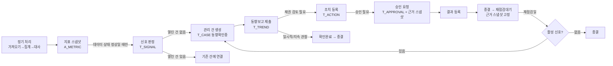

# 중도매인 통합관리 — 2단계 구현 안내 (v0.3.0-phase2)

| 항목 | 내용 |
|---|---|
| 범위 | 2단계: 조기 신호 · 관리 건 · 동향보고 · 채권 조치·승인 · 판단 근거 스냅샷 · 매뉴얼·서식 연결 · 운영 기준값 관리 |
| 작성일 | 2026-11-01 |
| 자료 | 중도매인·금액·사용자·문서·절차는 모두 **가상**이다. 실제 규정이 아니다 |
| 전제 | 1단계 안내(`02_1단계_구현안내.md`)의 설정·배포 절차를 마친 상태 |

---

## 1. 회사 자료와 코드의 분리 (요청 반영)

| 두는 곳 | 내용 | 비고 |
|---|---|---|
| 깃허브 | 코드, 가상 데이터 생성기, 설계·안내 문서 | `.gitignore` 로 CSV·엑셀·HWP·PDF·`data/` `internal/` `settings/` 제외 |
| 내 구글 드라이브 `중도매인통합관리/` | 원천 파일, 서식 원본(`10_원본서식`), 관리 건 폴더(`20_관리건`), 증빙, 백업, 저장소 시트 6개 | 폴더·파일 ID는 스크립트 속성에만 저장(코드에 없음) |
| 드라이브 `DB_MASTER.M_SETTING` 시트 | **연체 정의, 한도 결합 방식, 신호 기준값 등 실제 운영 기준** | 코드에는 `SETTING_DEFAULTS` 의 **가정값**만 있고 `is_assumed=true` 로 적재됨. 웹앱 "지표·신호 기준" 화면에서 수정 |
| 드라이브 `M_DOC / M_DOC_VER / M_SITUATION / M_PROCEDURE` 시트 | 매뉴얼·서식 버전, 상황 코드, 절차·조항·쪽수 | 웹앱 "매뉴얼·서식" 화면에서 등록. 문서 본문은 드라이브 파일, 시트에는 파일 ID·해시만 |

회사 기준을 반영할 때 저에게 원문을 보낼 필요가 없습니다. 본인이 웹앱 화면에서 값·조항을 직접 입력하면 됩니다. 입력 전까지 시스템은 해당 항목을 "가정값" 또는 "확인 필요"로 표시합니다.

---

## 2. 추가된 파일

| 파일 | 역할 |
|---|---|
| `gas/Metrics.gs` | 공통 지표(회전율·회수일수·평균잔액·연체·한도 사용률·구매 증감 3종), 신호 판정 규칙 S01~S07, 신호 구간 갱신, 관리 건 연결 규칙 — 순수 함수 |
| `gas/Signals.gs` | 정기 처리 "지표·신호" 단계: 설정 읽기 → 지표 스냅샷(`A_METRIC`) → 신호(`T_SIGNAL`) → 관리 건(`T_CASE`) 생성 |
| `gas/Work.gs` | 관리 건 상태 전환, 동향보고(임시/제출/버전), 조치, 승인, 판단 근거 스냅샷, 종결, 재점검, 업무 대기열 |
| `gas/Docs.gs` | 상황 코드 → 절차 → 서식 연결, 절차 안내 생성, 작성본 생성(원본 복사 후 자리표시자 치환), 제출본 잠금, 문서·절차 등록 |
| `gas/Config.gs` | `DB_WORK` 스키마, `M_SETTING` 등 추가 시트, `SETTING_DEFAULTS`(가정값), `SIGNAL_RULES`, `ACTION_TYPES` |
| `gas/Client.html` | 화면: 통합 홈 대기열 7종, 동향관리, 채권관리, 관리 건 상세, 지표·신호 기준, 매뉴얼·서식, 통합 상세의 지표·신호 구역 |
| `tests/run_tests_phase2.js` | 2단계 검증 73개 |

새 저장소: `DB_WORK` (신호·관리 건·동향보고·조치·승인·근거 스냅샷·첨부·상태 이력). `setupSystem` 재실행으로 생성된다.

---

## 3. 업무 흐름이 코드에서 어떻게 이어지는가

| 단계 | 책임 | 구현 규칙 |
|---|---|---|
| 신호 | 시스템 | 데이터 상태가 정상이 아니면 판정하지 않고 기존 신호를 "보류"로 둔다. 같은 규칙의 연속 충족은 한 구간(행)으로 유지하고 `last_date` 만 갱신. 연속 5회(가정) 미충족 시 "해소" |
| 관리 건 | 시스템 생성, 채권담당 책임 | 중도매인당 열린 건 1개. 종결 후 90일(가정) 내 재발은 새 건 + 이전 건 연결. S06(기한 도래)만으로는 생성하지 않음 |
| 동향보고 | 경매사 | 확인일·확인 방법·**확인된 사실 1건 이상**·결과 분류·재점검일 필수. 의견은 별도 칸. 제출 후 수정은 새 버전. 공식 원본은 시스템 입력, 파일 제출 시 최소 필드만 화면 입력 |
| 조치·승인 | 채권담당 / 승인권자(관리자) | 거래제한·한도변경·담보요청·거래조건 변경은 항상 승인 필요. 요청자 본인 승인 금지. 승인 전 결과 등록 불가 |
| 종결 | 채권담당 | 열린 조치 0건·승인 완료·종결 사유·재점검일(미래) 필요. 종결 시 근거 스냅샷 생성 |
| 근거 스냅샷 | 시스템 | 승인 요청·종결 시점의 한도·담보·보증(보증인 참조 제외)·지표·신호·매뉴얼 버전·기준값을 저장. 이후 변경과 무관 |

### 신호 규칙 (모두 가정값, `M_SETTING` 에서 변경)

| 코드 | 조건 | 비고 |
|---|---|---|
| S01 회전율 저하 | 최근 91일 회전율이 직전 91일 대비 30%↑ 하락 AND 회수일수 ≥ 20일 | 신규(12개월 미만)는 "참고" |
| S02 미수금 증가 | 잔액 ≥ 3개월 평균 × 1.3 AND 증가액 ≥ 1,000만원 | |
| S03 연체 | 원천 연체금액 > 0. 30일↑ "장기화"(위험) | 연체 정의 확인 전 원천값 |
| S04 구매 급감 | 전년 동월(동일 경과 경매일) ≤ −40% AND 직전 3개월 환산 ≤ −30% AND 부류 전체 대비 ≤ −20%p | 신규·휴업·폐업 제외 |
| S05 한도 사용률 | ≥ 80% 주의, ≥ 95% 경고 | **`LIMIT_COMBINE` 이 "미확인"이면 산출·생성하지 않음** |
| S06 기한 도래 | 담보 만기·보증 종료 60일 이내 | 관리 건 생성 안 함 |
| S07 복수 징후 | S01~S05 중 2개↑ | 개별 신호 심각도 한 단계 상향 |

---

## 4. 회사 기준을 넣는 순서 (운영 전)

| 순서 | 화면 | 입력 | 입력 전 시스템 동작 |
|---|---|---|---|
| 1 | 지표·신호 기준 | `OVERDUE_DEFINITION`, `LIMIT_COMBINE`, `LIMIT_BASE_AMOUNT`, `CATEGORY_AR_SPLIT` — 규정 확인 후 "확정"으로 저장(근거 조항을 사유에) | 연체는 원천값, 한도 사용률 산출불가, 부류별 회전율 미산출 |
| 2 | 지표·신호 기준 | S01~S07 수치 — 시뮬레이션으로 최신 기준일 신호 건수 확인 후 저장 | 가정값으로 신호 생성(가정값 표시) |
| 3 | 매뉴얼·서식 | 서식 원본을 `10_원본서식` 폴더에 올리고 문서·버전 등록(파일 ID). 자리표시자 `{{상호}}` 등 삽입 | 서식 없음 → 작성본 생성 불가 |
| 4 | 매뉴얼·서식 | 상황 코드(조건 JSON)와 절차 단계(문서·버전·조항·쪽수·필요 서식) 등록 | 절차 없음 → "확인 필요", 절차 생성 안 함 |
| 5 | 사용자·권한 / 기초자료 | 승인권자 역할, 담당 경매사 지정 | 승인권자 = 관리자 |

가상 데이터(`loadVirtualData`)에는 위 항목의 **가상 예시**가 들어 있다(가상 매뉴얼 2종, 가상 서식 2종, 상황 코드 4개). 실자료 운영 시에는 넣지 않는다.

---

## 5. 검증 결과

`node tests/run_tests.js` 77개 통과(1단계 회귀) · `node tests/run_tests_phase2.js` **73개 통과**. 전체 출력 `docs/05_2단계_검증결과.txt`.

| 시나리오 | 확인 내용 | 결과 |
|---|---|---|
| 1 회전율 저하 → 종결 연결 | W0123: S01+S03+S07 자동 생성 → 관리 건·담당 경매사·기한 → 담당 외 경매사 거부 → 사실 없는 제출 거부 → 제출 시 조치진행 → 절차 3단계·조항·서식 안내 → 작성본 자동 입력(원본 불변) → 한도 조정 조치(승인 필요) → 승인 전 결과 등록 거부 → 근거 스냅샷 → 관리자 승인 → 제출본 잠금 → 결과 등록 → 종결(재점검대기) → 재점검 시 활성 신호 있어 재개 | 33/33 |
| 2 계절 감소 비판정 | W0207 사계과일 S04 없음(전년 동월 조건이 계절성 차단), 시뮬레이션은 저장 안 함 | 3/3 |
| 4 확장 중복 | 재실행 후 신호·관리 건·지표 수 불변, 데이터 비정상 시 보류 → 정상화 후 연결 복귀 | 4/4 |
| 5 부류별 회전율 미생성 | 과일·채소 회전율 행 없음, "미산출" 사유 행 명시 | 3/3 |
| 6 근거 없으면 절차 없음 | 미등록 상황 "확인 필요" 절차 0줄, 두 문서 → "충돌" 둘 다 표시, 시행일 전 문서 미사용, 미등록 서식 거부 | 6/6 |
| 8 확장 근거 보존 | 한도·기준값 변경 후 스냅샷 값 유지, 현재 조회는 새 값 | 3/3 |
| 묶음 규칙 | 열린 건 재사용, 90일 내 재발, 90일 후 신규, S06 단독 미생성 | 5/5 |
| 기준값 | 25개 가정값, 허용값 검증, 확정 입력 후 한도 사용률·S05 산출 시작, 채권담당 변경 거부 | 6/6 |
| 지표·신호 | 기준일, 회전율 하락, 회수일수, 한도 사용률 산출불가, 근거·기준값 저장, 신규·휴업 제외 | 10/10 |

`node tests/render_ui.js` — 관리자·경매사로 홈·동향관리·채권관리·관리 건 상세·기준·매뉴얼 화면을 밝은/어두운 모드로 열어 스크립트 오류·가로 넘침 없음 확인.

---

## 6. 알려진 한계

1. **신호 기준값은 검증되지 않은 가정값**이다. 과거 사례 백테스트·그림자 운영 집계(설계 6.5)는 3단계에 구현한다. 지금은 최신 기준일 시뮬레이션만 가능하다.
2. **알림(이메일)은 아직 없다.** 홈 대기열로만 확인한다.
3. **작성본 자동 입력은 Google 문서와 텍스트 파일만** 지원한다. HWP·Word·PDF 서식은 복사만 되고 "자동 입력 불가" 표시가 뜬다. → 서식을 Google 문서로 변환해 두는 것을 권한다.
4. **절차 안내의 상황 코드 조건**은 신호·결과 분류·연체일수·관리 건 상태 조합만 지원한다. 더 복잡한 조건은 코드 수정이 필요하다.
5. **재점검일 도래 알림·자동 재점검은 없다.** 홈 "재점검 예정"에 "도래" 표시만 하고 사람이 실행한다.
6. **SLA 기한 계산은 경매 일정(M_CALENDAR) 기준**이다. 일정이 등록되지 않은 기간은 달력일로 대체된다.
7. **관리 건 분리·병합 기능은 없다.** 중도매인당 1건 운영을 전제로 한다.
8. 1단계 한계(전체 재집계, 연도별 분할 없음, 셀 수 한도 미확인)는 그대로다. 지표 스냅샷(`A_METRIC`)이 기준일마다 중도매인 × 약 20행 쌓이므로 1년이면 약 20명 × 300일 × 20 = 12만 행이 된다. 실자료 규모에서는 오래된 스냅샷을 월말분만 남기는 정리가 필요하다.

---

## 7. 운영·복구 추가 항목

| 상황 | 조치 |
|---|---|
| 신호가 너무 많거나 적음 | 지표·신호 기준 → 시뮬레이션으로 건수 확인 → 값 변경(사유 필수). 변경 전 신호에는 당시 기준값이 남아 있음 |
| 잘못된 신호 | 관리 건 상세에서 경매사 "오탐 의견" → 채권담당·관리자 "오탐 확정". 사유는 기준 조정 자료로 집계 |
| 데이터 비정상으로 신호 보류 | 가져오기·오류 점검에서 원인 해결 → 정기 처리 → 자동으로 "연결" 복귀 |
| 종결했는데 신호가 계속 남음 | 재점검 실행 시 자동 재개. 해소 판정은 연속 5회(가정) 미충족 기준 |
| 문서 개정 | 매뉴얼·서식 → 버전 등록(시행일). 이전 버전은 시행 전날 종료, 과거 관리 건 스냅샷은 당시 버전 유지 |
| `DB_WORK` 손상 | 백업 복구(`restoreDb('DB_WORK', ...)`) → 복구 후 정기 처리 재실행(신호는 재판정, 관리 건·보고·조치는 백업 시점 이후분을 `L_AUDIT` 로 확인) |

---

## 8. 3단계로 넘어가기 전 확인할 것

1. 실제 Google 환경에서 `setupSystem` 재실행 → `runPipeline` 실행 시간(`L_JOB` SIGNALS 단계 포함) 확인.
2. 4장 순서대로 회사 기준 입력 — 특히 `LIMIT_COMBINE` 과 연체 정의.
3. 과거 채권 사안 목록(익명 코드·시점)을 준비하면 3단계 백테스트로 기준값을 검증할 수 있다.
